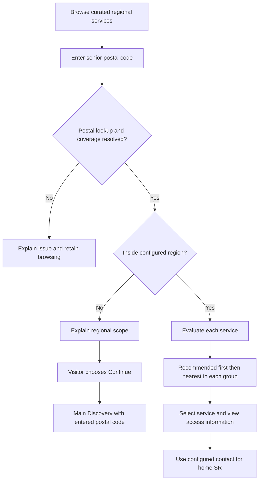

# Regional Discovery Embed Design

Date: 6 November 2026, Asia/Singapore

Status: Draft for user review. Product rules below are agreed; interaction proposals and defaults await review. Implementation and release are not authorised by this document.

## Purpose and success

Give seniors and caregivers an initial recommendation of providers to approach, based on the support they need and the senior's residential postal code. Frontline partners can then assess the enquiry and direct or route the person further. This supports the network's no wrong door intention while acknowledging service responsibilities across ICCP sub-regions.

The first use case is a caregiver seeking day care for an elderly parent in Bukit Batok. Success means they can identify relevant providers, understand the service and access route, and reach the appropriate enquiry contact. A recommendation does not confirm eligibility, capacity or admission.

The internal Bukit Batok handbook supplies context and service vocabulary. It is not approval to publish its contents, an exact postal-routing dataset, or a definitive source of service assignments. Confirmed network data is required before recommendations can be enabled. CareAroundSG remains an independent platform; this feature implies no agency endorsement.

## Scope and chosen approach

Two approaches were discussed:

| Approach | Tradeoff | Decision |
| --- | --- | --- |
| Extend the current compact embedded map | More shared behaviour, but postal search, ranking and richer cards would touch an established presentation contract | Not selected |
| Add an optional regional Discovery view | Another view to maintain, with a clear boundary around regional rules and interactions | Selected by the user |

The regional view is a **mini curated Discovery**: a directory on the left and map on the right. The left pane switches from its result list to a resource detail card. It uses only the directory's curated, published, currently public-approved services, including home-based services intentionally shown without map pins. Existing compact embeds retain their default presentation; ordinary Discovery retains its current ranking and contact behaviour.

This first version excludes account actions, profile updates, browser geolocation, owner tools, exports, private notes/files/images, case recording, enquiry submission and automatic referral. It does not activate the separately gated organisation-map pilot. AI recommendations and map-area-based filtering are outside this scope.

## Agreed flow

1. A visitor opens a partner website containing the regional view.
2. They choose a service such as day care from the service dropdown and enter the senior's six-digit Singapore postal code. The curated view has no free-text resource search; the postal-code input remains available.
3. The system resolves the address, identifies its home SR and evaluates the relevant curated services.
4. For an address inside the configured region, show recommended services first, followed by other relevant services, whether or not they have map pins. Order each group by appropriate known distance and show distance pills where calculable.
5. Hovering a map resource previews its details in place of the left directory list. Clicking keeps the detail open so the visitor can understand the access route and use the configured enquiry contact. A **View service** action opens and locks left-side details directly from any directory entry, including services without pins.
6. For a confirmed address outside the region, show an explanation and a **Continue to CareAroundSG** button. Only that explicit action opens main Discovery in a new tab, carrying the entered postal code. The partner website stays available.

## Recommendation and ordering rules

**Region** means the configured collection of SRs. **Home SR** means the SR containing the senior's entered postal code; it never means the caregiver's saved account location. A **service entry** is an individually curated service/resource, not a whole category, organisation or shared map pin. Its assigned SR or SRs represent confirmed service responsibility, not an inference from office coordinates.

Some home-based services intentionally have no pin. They are first-class directory entries and can be recommended through the same audience-zone-first and SR-fallback rules. An intentionally unplotted service is distinct from an entry whose expected coordinates are missing or invalid; either can remain in the directory when its membership and publication permissions are valid. Inclusion, recommendation and publication membership are never inferred from whether a pin exists.

Proposed compatibility default for review: where a service has several confirmed SR assignments and no audience zone, matching any assigned SR is sufficient for the fallback rule. The user has not separately defined this multiple-SR case.

| Entry configuration | Entered postal code | Recommended indicator |
| --- | --- | --- |
| Audience zone configured | Matches its effective zone | Show |
| Audience zone configured | Outside its zone, even when the entry is assigned to home SR | Do not show; retain the entry |
| No audience zone configured | Entry is assigned to home SR | Show |
| No audience zone configured | Entry is assigned to another SR | Do not show; retain the entry |

Audience-zone matching is authoritative when configured. A non-match never falls back to an SR recommendation. Existing service/host zone inheritance should be resolved through the established resource metadata, rather than inventing a new inheritance rule. Zone and SR identifiers remain server-side implementation details.

Relevant curated entries sort by **recommended first, then distance ascending within each group**. Proposed distance default: when a home-delivered service has no appropriate public service point, omit its distance pill and preserve stable published order among entries without known distance in that recommendation group. Known-distance entries precede unknown-distance entries within each group; equal known distances also use stable published order. Missing or invalid coordinates similarly produce no fabricated distance. Filtering determines relevance; recommendation does not grant visibility or remove unmatched services.

Home delivery does not mean every such service must be unplotted, and this design does not universally prohibit distance to a provider office. Where an appropriate public service point is deliberately published, ordinary map and distance behaviour can apply. A missing pin alone is not a reason to invent or reject a distance point. No private client-home or fabricated provider coordinates are created to place a service on the map.

If the home SR has no required service, other relevant regional options remain available by distance. An explicit audience-zone match can still recommend a service assigned elsewhere. Multiple services at one location are evaluated individually; sharing a pin does not transfer one service's recommendation to another.

Distances describe proximity, not journey time or entitlement. Public wording uses **Recommended for this location** and **Other options**; internal boundary and audience-zone labels are not exposed.

## Contact controls

The user agreed that email and phone are independently configurable for each selected service in this embedded directory.

| Mode | Display and action |
| --- | --- |
| Original | Show the service's usual approved contact for that field |
| Hidden | Omit that field and its action |
| Replace | Show the configured enquiry contact for that field |

ICCP replacement contacts follow the senior's **home SR**, even when the selected provider is in another SR. Label the recipient clearly, for example **ICCP enquiries**, so the visitor knows whom they are contacting. Provider records and ordinary Discovery contacts remain unchanged.

Proposed first-version default: replacement means an approved home-SR coordination email or phone, configured once per SR and selected per service/field. Arbitrary per-service replacement destinations are deferred. Original is the default for new contact controls; missing permission can still suppress that original field.

Publishing replacement mode requires an approved value for that field for every included SR. If a value subsequently becomes unavailable or its permission is withdrawn, suppress that field, explain that the contact is temporarily unavailable, and preserve any separately valid contact. Never substitute the provider's SR contact or silently restore its original value. Before a home SR is resolved, replacement actions stay unavailable with a prompt to enter the senior's postal code; Original and Hidden retain their normal meaning.

Email and phone actions launch the visitor's email or telephone application. They do not send messages, create cases or submit referrals. No diagnosis, client identity or postal code is automatically inserted into a message. Website and other external fields retain their existing approved-publication rules.

## Interaction design

The user agreed a mini curated Discovery interaction with the directory on the left and map on the right: a service dropdown without free-text resource search, map-resource hover replacing the left directory list with resource details, and clicking to keep those details open. The map stays unobstructed. Home-based services without pins remain fully usable in that directory. The desktop single-resource behaviour below follows the existing Discovery state pattern; the shared-location adaptation, responsive layout, feedback and other defaults remain proposals for review.

### Browsing and selection

On desktop, use a left-hand directory pane and right-hand map with a service dropdown and postal controls. In browse mode the left pane contains the scrollable result list; in preview mode it contains the selected resource detail card. Match DOM and keyboard reading order to the left directory followed by the right map where practical. Service selection and postal entry can happen in either order. The dropdown includes All services and the curated service categories; there is no separate text-search field. On small screens, the proposed **List** and **Map** views retain the same results and selection and start with the full directory list, including all matching home-based and unplotted entries. This mobile arrangement remains a review proposal; current main Discovery uses a bottom detail drawer.

With a fine pointer, hovering a single-resource map pin automatically replaces the left directory list with that resource's transient detail card. No resource-detail popover covers the map. Leaving the unclicked pin immediately restores the directory list, matching Discovery; there is no delayed pointer bridge from the pin into the left detail card. Click the pin first to keep its detail open while moving into the card or using its controls.

Clicking a map resource locks its side detail open. Other map hover activity does not replace the locked detail. **Back**, **Close**, Escape or clicking an empty map background restores the directory and its recorded scroll position; clicking another map resource changes the locked detail. Postal context, service filter and map viewport are preserved when returning to the directory.

For a plotted entry, directory-row hover highlights the corresponding map location without replacing the row or list; row click locks that map selection while the directory remains visible. An unplotted entry has no map-highlight requirement. Every entry's explicit **View service** button opens and locks its left-side detail, including its valid contact modes and home-SR enquiry route, without requiring map selection or coordinates. If a service-dropdown change removes the selected entry, clear its selection/detail and announce the updated count.

Proposed embed adaptation for a location containing several services: show the service chooser in the side directory pane, keeping the map clear. Clicking the map location keeps the chooser open; selecting one service opens and locks its detail. Back from that detail returns to the same chooser; returning from the chooser restores the directory context. Current Discovery anchors its shared-location chooser on the map, so the side-pane chooser is a deliberate review proposal rather than an assertion of exact reuse.

Postal submission can fit the visible result pins once when at least one exists. Selecting a plotted result can bring its pin into view. Panning and zooming subsequently explore the map without changing result membership, ordering or recommendations. **Reset map** restores the current plotted results' extent; **Clear postal code** removes the location context and its dependent indicators, distances and replacement contacts. These are distinct actions.

When all matching entries are home-based or otherwise unplotted, keep the regional basemap visible at the region extent and explain that these services are listed in the directory and may be provided at home. Do not fit empty bounds or show a no-services error merely because no pins are present. The full matching directory and View service actions remain available, including in mobile List mode.

### Location changes and feedback

Postal input uses explicit submission, with an adjacent error for an incomplete or invalid code. Keep ordinary browsing available during lookup. When a new postal code is submitted, immediately retire the previous recommendation state, distance labels and home-SR replacement actions. Commit the new results, indicators and contact recipient together. Cancel or ignore older responses so a slow lookup cannot restore a previous SR's contacts.

Until location evaluation completes, retain the filtered curated list in published order with a calm checking message. A failed lookup offers retry and does not label the address outside the region. Clearing input returns to browsing; it never changes a profile. Visitor state stays in temporary tab memory and is not added to analytics or account records.

For a confirmed outside-region address, retain the curated directory for browsing without regional recommendations, distance labels or ICCP replacement actions. Show the explanation and explicit continuation button. Use the existing main Discovery postal handoff; do not carry saved Home data or silently broaden the embedded catalogue. Service-filter handoff should use an existing supported main-Discovery filter only; otherwise the destination offers its normal service search.

### Touch, keyboard and iframe behaviour

Preserve the host website's normal scrolling. Mobile map gestures require deliberate **Tap to interact** activation, with **Done** and Escape releasing the map. Touch users tap a map resource or activate View service to open locked details; they do not depend on hover, and retain the proposed List/Map choice. Keyboard users can activate a focusable pin or View service with Enter or Space to open and lock the side detail. Back, Close and Escape restore context and return focus appropriately. All controls, service rows, pin alternatives, details and contact actions remain reachable with visible focus. No information depends on hover, colour or dragging alone.

Use labelled controls, at least 44-pixel touch targets, announced loading/result updates and reduced-motion support. Bound the embedded height, maintain a usable internal result scroll area and retain attribution. A full-map link opens a public top-level view; it exposes no owner/account/export workflow inside the iframe.

## Configuration and failure behaviour

The authorised map curator selects Regional Discovery, its SR set, curated entries and per-field contact modes, then previews the saved configuration before explicitly publishing it. Existing access controls determine who can edit; this feature grants no new regional governance powers.

Proposed data contract: a versioned published configuration freezes catalogue selection, presentation and contact-mode intent. The catalogue explicitly includes curated entries without pins; it is not derived only from rendered pins or pin visibility. It references validated SR boundary and audience-zone records. Current authoritative coverage and public-permission records are evaluated on each request, so published pages cannot retain a withdrawn approval or obsolete assignment. Saved configuration changes require explicit republishing; current policy changes can remove recommendations or contact availability without republishing. Neither path adds an uncurated service.

Publication validates non-overlapping SR postal membership, service SR references, effective zone validity and required replacement contacts. A service with configured but invalid zone data receives no fallback recommendation. A postal overlap, missing SR mapping or unavailable coverage lookup yields **coverage unconfirmed**, not **outside region**. Offer retry, general browsing and a voluntary main Discovery link without asserting a match.

With no postal code, show the curated list in published order without recommendation or distance indicators. With no matching services, explain that this directory has no matching result and offer filter reset or voluntary main Discovery continuation. No result state promises that suitable services exist elsewhere or that a place is available.

## Architecture and regression boundary

Add a versioned opt-in regional view/configuration around the existing read-only embed snapshot. Reuse Discovery's postal-resolution, distance and browse/detail interaction patterns where their contracts fit. Borrow its selection, hover, locked-detail and scroll-restoration state pattern rather than embedding its live-fetch, Save or account-capable detail component unchanged. Regional details read only the permitted published payload. Add the audience-zone-over-SR evaluation and recommendation-first ordering as regional-embed behaviour, leaving the existing Discovery indicator endpoint and its ordering untouched.

The server must intersect every evaluation with the published service allowlist and current public visibility. Regional catalogue membership is independent of map-pin membership, so service-only entries survive publication, matching and response construction. Return only safe per-entry recommendation status and resolved approved contact presentation, not boundary lists, region/zone IDs, private profile context or hidden-resource IDs. Existing public coordinates used for map pins remain public; private home coordinates must not be returned. Boundary lookup, input validation, bounded evaluation and rate limits belong at the server boundary.

Preserve exact-origin framing, no-store responses, live disable/unpublish/revoke behaviour, current per-field content permissions, frozen shared-map semantics and all private-media exclusions. A contact replacement cannot bypass publication approval. This design does not change the organisation pilot stages or reuse private governed-map routes as a shortcut.

The active documentation worktree is based on an older August revision. Implementation must first be scoped from a freshly verified current-main worktree of the same repository; no environment files are copied. Schema/API details remain builder decisions within these contracts.

## Future acceptance checks

These checks describe required implementation evidence, not tests run for this draft.

| Scenario | Required result |
| --- | --- |
| Zone matches a service assigned outside home SR | Recommended, with the home-SR replacement contact |
| Zone excludes postal but service is assigned to home SR | Visible without recommendation; no SR fallback |
| No zone, assigned home SR | Recommended |
| Home SR lacks service | Other curated regional options remain available by distance |
| Mixed recommendations, equal/missing distances | Correct groups, stable ties, missing distances last within group |
| Intentionally unplotted home-based service matches postal | Service remains a published directory member and can be recommended through the same zone/SR rules |
| Home care-only results with no pins | Full matching list and contacts remain available; regional basemap and region extent remain, with an explanation rather than a no-services error or fit-to-empty bounds |
| View service without coordinates | Locked left-side details and valid Original/Hidden/Replace contacts work without selecting or fabricating a map pin |
| No appropriate public distance point | No invented distance pill; stable published ordering among unknown-distance entries inside each recommendation group |
| Desktop layout and reading order | Directory and details occupy the left pane, map stays on the right and unobstructed; practical DOM/keyboard order follows that arrangement |
| Several services share a location | Independent recommendations and correct detail/contact selection |
| Service filtering | Dropdown includes curated service categories and All services; no free-text resource search appears; postal input and main Discovery search remain available in their own contexts |
| Desktop map hover and click | Map-pin hover replaces the side directory with detail; leaving an unclicked pin immediately restores browse; clicking keeps detail open and other hover cannot replace it |
| Directory-row interaction | Hover highlights the map; row click locks map selection while the list remains; View service explicitly opens locked side detail |
| Returning to the directory | Back, Close, Escape or empty-map click restores list scroll, filters and viewport; no resource detail covers the map |
| Shared-location adaptation | Side-pane chooser opens the correct service detail; Back returns to the chooser and then directory context |
| Keyboard and touch previews | Enter/Space or explicit tap opens locked details without hover; focus returns predictably; proposed mobile List/Map remains usable |
| Email/phone modes differ across services | Each field obeys its own mode; provider record is unchanged |
| Postal changes while details are open | No stale recommendation, distance or wrong-SR contact action |
| No/invalid/ambiguous/unresolved postal | Safe browsing; no false recommendation or outside-region assertion |
| Confirmed outside-region postal | Explicit handoff, same entered postal, destination prioritises it over Home |
| Consent/contact/visibility revoked | Affected content disappears on the next response; no unsafe fallback |
| Guest payload inspection | No private/profile/zone/boundary or editor data exposed |
| Desktop, mobile, keyboard and slow responses | Selection, focus, scrolling, retry and cancellation remain usable |
| Existing Discovery, Shared Map and compact embed | Existing ranking, contacts, framing and sharing contracts pass unchanged |

Before release, use the project client build, server suite, focused browser/locked-surface checks and release checklist. Record a new regression baseline only after implementation is verified. Deployment requires its own authorisation.

## Review and source grounding

The user has agreed the product purpose, optional-view approach, recommendation precedence, recommendation-first ordering, per-service phone/email controls, home-SR ICCP routing, explicit outside-region handoff, service-dropdown filtering without free-text resource search, home-based services without pins, and the mini curated Discovery model with a left directory and right map: map-resource hover replaces the left directory with details and click keeps them open. The side-pane shared-location chooser, mobile presentation, distance defaults for services without an appropriate public point, temporary-state handling, publication validation and live-policy behaviour remain proposed defaults for review. Main Discovery's search is unchanged.

The user requested a clickable interaction companion, shown alongside the written design in chat. It uses fictional services, coverage, postal cases and contacts to explore the proposed behaviour. Its sample postal results are simulated, not real routing data. It makes no live API calls, enquiries or Discovery handoff. Requesting the companion does not approve its layout or authorise product implementation.

During the interaction review, check:

- The service dropdown filters the curated entries, with no separate resource text search; postal entry still works.
- The directory is on the left and the map on the right; detail cards replace the left directory and leave the map clear.
- A home-based service without a pin remains in the directory, can receive the appropriate recommendation, and opens its details and contact route through View service.
- Home care-only results with no plotted points retain the full list and regional basemap, without a no-services error or fabricated pin/distance.
- Hovering a desktop map pin replaces the directory list with transient side details; leaving the unclicked pin restores the list, while clicking keeps details open for interaction.
- Directory-row hover highlights the map while retaining the list; row click keeps that map selection, and View service opens locked side details.
- Back, Close, Escape and empty-map click restore the directory's scroll and filter context; no resource detail obscures the map.
- The proposed side-pane shared-location chooser opens the selected service detail and returns to the chooser on Back.
- Changing the home-SR postal case updates recommendations, ordering and replacement contacts together, without retaining the previous SR's contact action.
- An AAC excluded by its configured audience zone stays visible without a recommendation, including in the same SR.
- Recommended results appear first, with distance ordering within both recommended and other results.
- Original, Hidden and Replace work independently for phone and email on each selected service.
- An outside-region case explains the scope and offers an explicit continuation action; the companion simulates that action rather than navigating to the live service.

Source inspection used cached `origin/main` revision `3bb5ec18` recorded on 5 November 2026, not a fresh production check:

- `docs/regression-ledger.md`: selected-view embed snapshot and Discover location-indicator locks; permission-first publication record remains labelled release candidate.
- `docs/session-handoff.md`: organisation pilot stages remain off and require separate activation evidence.
- `client/src/features/discover/useDiscoveryLocation.js`: explicit postal URL context takes precedence over saved Home without changing the profile.
- `client/src/pages/DiscoverPage.jsx`: desktop map hover switches the directory to details, map click locks the selection, row hover highlights only, and returning to browse restores recorded list scroll. Single-pin hover-end clears immediately unless locked; mobile uses a bottom detail drawer.
- `server/src/utils/discoveryLocationIndicators.js`: current regional and audience-zone booleans are separate indicators, not this new ranking hierarchy.
- `server/src/utils/embeddedResourceContacts.js` and `server/src/controllers/sharedMapsController.js`: sanitised snapshot contacts and current embed-specific public-content policy; email requires deliberate new handling.

Before activation, an authorised network steward must validate the regional SR/postal dataset, each service's effective zone or assigned SR, and the approved home-SR enquiry contacts. These are operational inputs, not facts inferred from the internal handbook.
